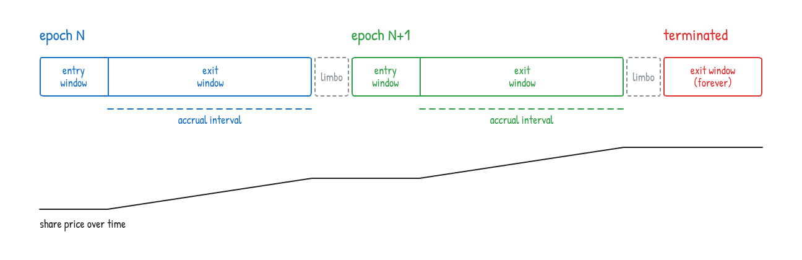

# 🏦 ERC-8416: Epoch-Based Fixed-Rate Vault

Reference implementation of [ERC-8416](https://ethereum-magicians.org/t/erc-8416-epoch-based-fixed-rate-vault/29669): an [ERC-4626](https://eips.ethereum.org/EIPS/eip-4626) vault that pays a **fixed rate** over **scheduled epochs**, with deposits that settle right away and redemptions that go through a request queue ([ERC-7540](https://eips.ethereum.org/EIPS/eip-7540)).

## ⚙️ How it works



*This is one example schedule. Each epoch sets its own windows, so they can be longer, shorter, overlap, or leave gaps.*

- **Entry window**: `deposit` / `mint` are open, up to the epoch's deposit cap.
- **Accrual interval**: `totalAssets` grows at the epoch's fixed APR, so the share price only rises here. Interest compounds from one epoch to the next.
- **Exit window**: holders call `requestRedeem`, the owner calls `fulfillRedeem`, then holders `redeem` / `withdraw`.
- **Limbo**: time between epochs, when deposits and redemption requests are both closed.
- **Strategy**: deposited funds go to an `IFixedRateStrategy`, which must return principal plus interest.
- **Termination**: after the last epoch ends, the owner pulls all funds back and the exit window stays open forever.

## 🗂️ Layout

| File | What |
| --- | --- |
| [`src/IERC8416.sol`](src/IERC8416.sol) | ERC-8416 interface |
| [`src/IERC7540.sol`](src/IERC7540.sol) | Async-redeem and operator interfaces (ERC-7540 / ERC-7575) |
| [`src/IFixedRateStrategy.sol`](src/IFixedRateStrategy.sol) | Strategy hook |
| [`src/FixedRateVault.sol`](src/FixedRateVault.sol) | Reference vault |
| [`test/`](test/) | Foundry unit and fuzz tests |

## 🚀 Quickstart

You need [Foundry](https://getfoundry.sh) and Node.js. Dependencies are installed with npm (no git submodules).

```bash
npm install        # OpenZeppelin + forge-std
npm run build      # compile
npm test           # run tests
npm run coverage   # coverage summary
npm run fmt        # format with Prettier
```

## ⚠️ Disclaimer

This is a reference implementation for discussing the standard. It has **not been audited**. Do not use it in production.

## 📜 License

[CC0-1.0](https://creativecommons.org/publicdomain/zero/1.0/)
